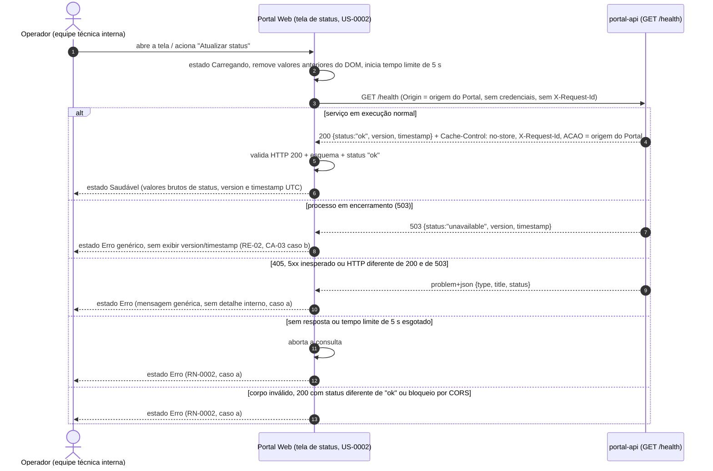

# ET-0001 — GET /health da `portal-api` (especificação técnica)

> [TESTE] DEM-2026-001 · TASK-0006 · Fluxo 01 · classe de risco R3 (DEC-ARQ-0001) · autora: AS (Juliana Castro).
> **v1.3:** acrescenta a testabilidade do HTTP 500 (US-0001 CA-09) por injeção somente na fábrica de teste, em espelho do §7.2 / DEC-ARQ-0002 L-05 — **proposta AS, confirmação final do ARQ no G3** (pedido do ORQ a partir do parecer G2 do FS, TASK-0008, item 5). O OpenAPI **não** é alterado (o gancho não integra a superfície do contrato).
> **v1.2 (mantida):** incorpora US/REQ/RN **v1.2 vigente** (G1; conteúdo da v1.1 / DEC-PO-0006, commit babb9fe) e as decisões L-01 a L-07 da **DEC-ARQ-0002** v1.0 (commit 15b3809; parecer prévio, **não é o G3**). Os ADR-0001/0002/0003 permanecem *propostos*; a stack depende da AH-0001. Tudo que ainda depende da stack está marcado literalmente como **"premissa a confirmar (AH-0001)"**. A validação do contrato (G3, TASK-0007) só ocorre após a AH-0001. Ressalva do G1: se os ADR mudarem no G3, o PO reabre os CA afetados.
> Contrato: `02-tecnica/contratos-api/portal-api/openapi.yaml` (OpenAPI 3.1, `info.version` **1.0.0**), **proposto** na main (merge `--no-ff` `cf660fb`; esse merge **não é o G3**).
> Especificação funcional par: EF-0001 v1.2 (a v1.3 desta ET não exige nova EF: a rastreabilidade do CA-09 já apontava ao §7.4).

## 1. Objetivo e escopo
Detalhar tecnicamente o recurso operacional `GET /health` da `portal-api` (API base do Portal Web, a criar): *liveness* do processo, somente leitura, que informa `status`, `version` e `timestamp` (REQ-0001) sem dado sensível (RN-0001, REQ-0004) e de forma que indisponibilidade nunca seja lida como saudável (RN-0002).

**Dentro:** rota, métodos, corpos, códigos HTTP, cabeçalhos, CORS, regras de consumo pelo Portal, tempo limite do cliente, alvo de desempenho, cenários de erro, impactos, compatibilidade e testabilidade.
**Fora (decisão de outros donos):** escolha de stack e estrutura (ARQ, ADR-0001), implementação (FS), tela (UX, US-0002), validação do contrato (ARQ, G3), modelo de dados (não há; DBA não acionado — ADR-0003 diretriz 4).

## 2. Fontes e versões consultadas
| Fonte | Versão / estado | Uso |
|---|---|---|
| ADR-0003 (health-check) | 1.0 · proposto · commit 362ea35 | Diretrizes do contrato (fonte principal) |
| ADR-0002 (SemVer e origem da versão) | 1.0 · proposto · commit 362ea35 | Formato e origem de `version` |
| ADR-0001 (stack base) | 1.0 · proposto · commit 362ea35 · aguarda AH-0001 | Somente premissas de stack e nomes de variáveis (D7) |
| DEC-ARQ-0002 | 1.0 · vigente · commit 15b3809 | Decisões L-01 a L-07 (parecer prévio; não é G3) |
| US-0001, US-0002 | 1.2 · vigente (G1; commit babb9fe; conteúdo funcional da v1.1 / DEC-PO-0006, af208f2) | CA a cobrir (CA-01 a CA-09 da US-0001) |
| REQ-0001..REQ-0004 | 1.2 · vigente (G1) | Requisitos |
| RN-0001, RN-0002 | 1.2 · vigente (G1) | Regras aplicadas |
| DEC-ARQ-0001 | R3 (historico.md, 26/11/2026 12:22) | Classe de risco |
| DEC-PO-0005, DEC-PO-0006 | registradas no histórico e em af208f2 | Validação do protótipo (RE-02); CA/REQ de 503/405/500 e CA-04 |
| DEC-AS-0001..0003 | transcritas na main pelo ORQ (commit ce01f57) | Tempo limite, tolerância, expressões (version apertada pela DEC-ARQ-0002 L-07) |
| contexto.yaml DEM-2026-001 | lido nas v4 a v10 (G1 aprovado com observações, b083eef) | Estado, riscos, pendências |
| Análise de testabilidade (QA, TASK-0005) | v1.0 · vigente · commit 80e9184 | Insumo; L-11 resolvida pelo PO |
| Especificação de interface da tela (UX) | UX-ESPEC-DEM-2026-001-TASK-0004 v1.0, aprovada com ressalvas (DEC-PO-0005, commit 1290f25) | Regras de consumo do Portal (seção 5) |
| Modelos para EF/ET/contrato | **inexistentes** em `modelos/` (L-09) | Estrutura própria derivada do PROMPT.md da AS |

## 3. Premissas dependentes da stack
Todas as linhas abaixo são **premissa a confirmar (AH-0001)**; nada nesta tabela altera o contrato.

| ID | Premissa (stack proposta no ADR-0001: Node.js 24 + Fastify 5, Portal estático) | Efeito se a stack mudar |
|---|---|---|
| PS-01 | Framework/servidor HTTP da `portal-api`, host e porta de escuta: premissa a confirmar (AH-0001). Padrão seguro citado no ADR-0001 D5/D7: interface de loopback; porta não definida (DEC-ARQ-0002 L-06: o ARQ não inventa porta) | Nenhum no contrato; muda só a ET/implantação |
| PS-02 | Forma de obter a `version`: lida **uma vez** na inicialização do `version` do manifesto do serviço e mantida em memória (ADR-0002 item 3; `package.json` é premissa a confirmar (AH-0001)); falha de leitura/formato ⇒ o serviço não inicia | Muda a origem; o formato SemVer do contrato permanece |
| PS-03 | Biblioteca que aplica o CORS: premissa a confirmar (AH-0001). A regra (variável `PORTAL_API_ALLOWED_ORIGIN` obrigatória, exata, sem curinga, fail closed) está decidida na DEC-ARQ-0002 L-06 | Nenhum no contrato |
| PS-04 | Remoção de cabeçalhos que revelem servidor/versão do runtime ou framework (ADR-0003): mecanismo premissa a confirmar (AH-0001) | Nenhum no contrato |
| PS-05 | Gancho concreto do encerramento gracioso (como o listener permanece no ar e passa a emitir `503`): premissa a confirmar (AH-0001). O comportamento exigido está na DEC-ARQ-0002 L-05 (ver §7.2) | Sem o gancho, o `503` pode não ocorrer na parada abrupta (o cliente trata timeout como indisponível, RN-0002); contrato mantido |
| PS-06 | Adaptação das respostas padrão do framework (`404`, `405`, `500`, `HEAD`, preflight `OPTIONS`) ao corpo e aos cabeçalhos padronizados: premissa a confirmar (AH-0001). O comportamento exigido está na DEC-ARQ-0002 (L-02, L-04) | Nenhum no contrato |
| PS-07 | Relógio injetável, geração de UUID v4 para `X-Request-Id` e injeção, na fábrica de teste, do estado de saúde (503) e da falha interna (500): forma concreta (assinatura da fábrica, nomes de argumentos, ferramenta de teste) é premissa a confirmar (AH-0001). O princípio dos ganchos está no §7.2 e no §7.4 | Nenhum no contrato |
| PS-08 | Ferramenta de medição do p95 local: premissa a confirmar (AH-0001) | Só OPS/QA |
| PS-09 | Validação do corpo da resposta contra o esquema (ex.: JSON Schema) no provedor e nos testes de contrato: premissa a confirmar (AH-0001) | Só testes |

## 4. Requisitos técnicos do contrato (RT)
Referência normativa: ADR-0003 (tabela "Diretrizes do contrato"), refinada pela DEC-ARQ-0002; a forma executável é o `openapi.yaml` 1.0.0.

| ID | Requisito técnico | Fonte | Seção do OpenAPI |
|---|---|---|---|
| RT-01 | Rota `GET /health`, sem parâmetros de consulta, sem corpo de requisição, sem efeitos colaterais (seguro e idempotente); fora do prefixo de versão | ADR-0003 | `paths./health.get` |
| RT-02 | Sucesso: `200`, `Content-Type: application/json; charset=utf-8`; corpo com **exatamente** `status`, `version`, `timestamp` (`additionalProperties: false` no provedor); nomes em minúsculas, ASCII, inglês | ADR-0003 | `schemas.HealthOk`, `responses.Ok` |
| RT-03 | `status`: no `200` sempre `"ok"`; `"unavailable"` reservado ao `503`; valores adicionais só em versão MINOR do contrato | ADR-0003 | `HealthOk.status`, `HealthUnavailable.status` |
| RT-04 | `version`: SemVer 2.0.0 do **serviço** (não do contrato), sem `+build`, sem hash, nunca vazio. Expressão oficial (DEC-ARQ-0002 L-07, aperfeiçoa DEC-AS-0003): `^(0\|[1-9][0-9]*)\.(0\|[1-9][0-9]*)\.(0\|[1-9][0-9]*)(-((0\|[1-9][0-9]*\|[0-9]*[A-Za-z-][0-9A-Za-z-]*)(\.(0\|[1-9][0-9]*\|[0-9]*[A-Za-z-][0-9A-Za-z-]*))*))?$`. Versão inicial do serviço 0.1.0 (ADR-0002); exemplos usam 0.1.0. Oráculo do CA-04: resposta = manifesto do serviço = tag de release (quando houver); **sem** hash de commit | ADR-0002, DEC-ARQ-0002 L-07, US-0001 CA-04 | `schemas.ServiceVersion` |
| RT-05 | `timestamp`: RFC 3339 / ISO 8601 em **UTC com `Z` e exatamente 3 casas de milissegundos** (`AAAA-MM-DDThh:mm:ss.sssZ`), gerado no momento da resposta pelo relógio do servidor; padrão regex no esquema (confirmado na DEC-ARQ-0002 L-07). Tolerância de verificação pelo QA: **±5 s** (DEC-AS-0002, confirmada) | ADR-0003, DEC-ARQ-0002 | `schemas.Timestamp` |
| RT-06 | `503`: mesmo formato do `200`, com `status: "unavailable"`; sem causa, sem detalhe e **sem `Retry-After`**. Disparo e testabilidade: seção 7.2 | ADR-0003, DEC-ARQ-0002 L-05, US-0001 CA-07 | `schemas.HealthUnavailable`, `responses.Unavailable` |
| RT-07 | Métodos diferentes de `GET` e do `HEAD` tolerado: `405` com `Allow: GET, HEAD` (DEC-ARQ-0002 L-02; refina o literal `Allow: GET` do ADR-0003), corpo de erro padronizado | DEC-ARQ-0002, US-0001 CA-08 | `responses.MethodNotAllowed` |
| RT-08 | Erros (`405`, `5xx` inesperado, e o `404` padrão do serviço): `application/problem+json` (RFC 9457) com **somente** `type`, `title`, `status`; padrão inicial da plataforma (DEC-ARQ-0002 L-01): `type: "about:blank"`, `title` = frase canônica do status HTTP em inglês, `status` = código numérico. Nunca stack trace, caminho, nome de máquina, variável de ambiente ou qualquer detalhe interno | DEC-ARQ-0002 L-01, RN-0001, REQ-0004, US-0001 CA-09 | `schemas.ProblemBase`, `ProblemMethodNotAllowed`, `ProblemInternalError`, `ProblemNotFound` |
| RT-09 | Cabeçalhos: `Cache-Control: no-store`; `X-Content-Type-Options: nosniff` em **todas** as respostas de `/health` e, como padrão do serviço, também no `404` de rota inexistente (DEC-ARQ-0002 L-04). ID de correlação `X-Request-Id`: UUID canônico de 36 caracteres, hex minúsculo com hífens (`^[0-9a-f]{8}-[0-9a-f]{4}-[0-9a-f]{4}-[0-9a-f]{4}-[0-9a-f]{12}$`); ausente ou inválido ⇒ o servidor gera UUID v4 e **não** retorna `400`. **Nenhum** cabeçalho que revele servidor, versão do runtime ou do framework | DEC-ARQ-0002 L-03, L-04 | `components.headers.*` |
| RT-10 | CORS: somente a origem do Portal configurada em `PORTAL_API_ALLOWED_ORIGIN` (obrigatória, valor exato, sem curinga; ausente, inválida ou `*` ⇒ o serviço não inicia — fail closed). Métodos `GET`/`HEAD`; sem credenciais. Premissa de teste: `http://127.0.0.1:${PORTAL_WEB_PORT}`; valores por OPS/FS (TASK-0012), não inventados aqui. Origem não permitida: status normal **sem** `Access-Control-Allow-Origin` e **sem 403** | DEC-ARQ-0002 L-06, ADR-0001 D7 | `headers.AccessControlAllowOrigin` |
| RT-11 | Sem autenticação (contrato interno); condição: execução local/rede interna. Exposição fora da rede interna ⇒ contrato público (R3 + N3, nova AH) | ADR-0003 | `security: []` |
| RT-12 | Dados proibidos em corpo e cabeçalhos: dados pessoais, credenciais, tokens, hostnames, IPs, caminhos, versões de runtime/dependências, hash de commit, variáveis de ambiente, estado de dependências | ADR-0003, RN-0001 | `HealthOk` (esquema fechado) |
| RT-13 | Tempo limite do cliente (Portal): **5 s** do início da consulta até a resposta completa; sem nova tentativa automática; esgotado ⇒ erro (RN-0002) — DEC-AS-0001 (confirmada na DEC-ARQ-0002 L-07 e aceita pelo PO como premissa) | ADR-0003, DEC-AS-0001, DEC-ARQ-0002, REQ-0003 | `info.description` |
| RT-14 | Desempenho: sem E/S externa; alvo **indicativo** de p95 ≤ 100 ms em execução local — **não é SLO**, não é critério de aceite; calibrar por OPS/QA | ADR-0003 | `info.description` |
| RT-15 | Observabilidade: log estruturado por requisição em nível `debug` para `/health`; erros em `error`; sem dado sensível. O `X-Request-Id` segue nos logs do servidor (o Portal não o lê) | ADR-0003, DEC-ARQ-0002 L-03 | — |
| RT-16 | `HEAD`: tolerado, mesmo código e cabeçalhos do `GET`, **sem corpo**; fora da superfície prometida (sem operação `head` no OpenAPI). `OPTIONS`: preflight CORS `204`, sem corpo, `Access-Control-Allow-Methods: GET, HEAD`, sem credenciais e sem `Allow-Headers` nesta demanda; **não** é `405` e **não** é operação de negócio no OpenAPI | DEC-ARQ-0002 L-02 | descrição de `/health` (não há `head`/`options` como operação) |
| RT-17 | Versionamento do contrato: SemVer próprio, inicial `1.0.0`, distinto da versão do serviço; campo novo opcional = MINOR; remoção/renomeação/mudança de tipo = MAJOR (ADR; AH se público) | ADR-0003 | `info.version` |

### 4.1 `HEAD` e `OPTIONS` (DEC-ARQ-0002 L-02)
- **HEAD** — tolerado com a semântica: mesmo código HTTP e os mesmos cabeçalhos do `GET`, **nenhum corpo**. **Não** integra a superfície prometida do contrato 1.0.0 (consumidores não devem depender dele; não há operação `head` no OpenAPI). O `Allow` do `405` é `GET, HEAD`.
- **OPTIONS** — não é operação de negócio e **não** responde `405`. O provedor implementa preflight CORS: `204`, sem corpo, `Access-Control-Allow-Origin` só se a origem for a configurada, `Access-Control-Allow-Methods: GET, HEAD`, sem `Access-Control-Allow-Credentials`, sem `Access-Control-Allow-Headers` nesta demanda (L-03). O GET do Portal continua "simples" (sem preflight). OPTIONS existe para um preflight futuro não quebrar. Não há operação `options` no OpenAPI.

## 5. Regras de consumo pelo Portal (consumidor tolerante)
Derivadas do ADR-0003, da DEC-ARQ-0002, da US-0002 v1.2 e da especificação de interface do UX (aprovada com ressalvas, DEC-PO-0005; sem alterá-la):
1. `fetch` com tempo limite de **5 s** (RT-13), sem cache (`cache: 'no-store'`; o servidor também envia `Cache-Control: no-store`), sem polling automático; consulta ao abrir a tela e a cada ação "Atualizar status". Toda consulta (primeira abertura ou atualização) passa pelo estado **Carregando** e os valores da consulta anterior são **removidos do DOM**, não apenas ocultados (US-0002 CA-04).
2. **Saudável somente se** HTTP `200` **e** corpo JSON com `status === "ok"`, `version` não vazia no padrão SemVer e `timestamp` válido (RT-05). Qualquer outra situação ⇒ **Erro/indisponível** (RN-0002, US-0002 CA-03):
   - caso (a): sem resposta/recusa de conexão, tempo esgotado, `405`, `5xx` inesperado, qualquer HTTP ≠ 200 e ≠ 503 de contrato, corpo inválido/fora do esquema, `200` com `status` ≠ `"ok"`, resposta bloqueada por CORS — a tela informa que o status não pôde ser obtido;
   - caso (b): HTTP `503` com `status` `"unavailable"` e esquema válido — a tela usa o **mesmo** estado de erro genérico e **não exibe versão nem timestamp** recebidos (RE-02 / DEC-PO-0005).
3. Campos desconhecidos no corpo são **ignorados** (leitor tolerante); o provedor, ao contrário, nunca os envia.
4. Valores anteriores nunca são apresentados como atuais; o Portal nunca assume "saudável" por padrão.
5. Dados da resposta inseridos no DOM **somente como texto**; mensagens de erro são constantes do front, nunca derivadas da resposta de erro. Status, versão e timestamp só aparecem no estado saudável (US-0002 CA-06).
6. O Portal **não envia nem lê** `X-Request-Id` nem outros cabeçalhos de requisição não simples (mantém a requisição sem preflight) — premissa da AS **confirmada** na DEC-ARQ-0002 L-03. Sem `Access-Control-Allow-Headers` nem `Access-Control-Expose-Headers` para esse cabeçalho.
7. A tela exibe os **valores brutos** iguais aos da **mesma** consulta, com o timestamp UTC no formato da API (US-0002 CA-01). A conversão para America/Sao_Paulo é adicional e **não substitui** o valor bruto (D-UX-05 e D-UX-08, aceitos em DEC-PO-0005).

## 6. Diagrama de sequência (Portal → portal-api)


## 7. Comportamento detalhado

### 7.1 Resposta `200` (US-0001 CA-01 a CA-04)
Exemplo normativo (dados fictícios; versão do serviço inicial 0.1.0 — ADR-0002):
```
HTTP/1.1 200 OK
Content-Type: application/json; charset=utf-8
Cache-Control: no-store
X-Content-Type-Options: nosniff
X-Request-Id: <UUID canônico aceito ou gerado (v4 se ausente/inválido)>
Access-Control-Allow-Origin: <origem do Portal; só quando a origem da requisição coincide>

{"status":"ok","version":"0.1.0","timestamp":"2026-11-26T15:30:00.123Z"}
```
- `timestamp` é gerado no momento da resposta (RT-05). Verificação do QA: |`timestamp` − instante de recebimento| ≤ **5 s** em execução no mesmo host (DEC-AS-0002, confirmada); em teste com relógio injetável (PS-07), igualdade exata ao instante simulado. O CA-03 também se aplica ao `timestamp` do 503.
- `version` é igual à versão do serviço em execução; o QA confere as fontes do ADR-0002 / US-0001 CA-04: resposta = manifesto do serviço do artefato testado = tag de release (quando houver). **Sem** exigir hash de commit na resposta. Origem: PS-02.

### 7.2 Resposta `503` (US-0001 CA-07, RN-0002)
```
HTTP/1.1 503 Service Unavailable
Content-Type: application/json; charset=utf-8
Cache-Control: no-store
X-Content-Type-Options: nosniff
X-Request-Id: <UUID canônico>

{"status":"unavailable","version":"0.1.0","timestamp":"2026-11-26T15:30:05.456Z"}
```
- **Critério de disparo (ADR-0003 + DEC-ARQ-0002 L-05):** processo em encerramento (hoje não há dependência). No encerramento **gracioso**, enquanto o listener estiver no ar, o processo **deve** responder `503` com `status: "unavailable"`. Se a parada for abrupta, o cliente esgota o tempo e trata como indisponível (RN-0002). O gancho concreto depende da stack (PS-05, AH-0001).
- **Sem `Retry-After`** nesta versão (DEC-ARQ-0002 L-05).
- **Testabilidade:** o `503` é testável **somente** por injeção na fábrica da aplicação (estado de saúde injetável, no mesmo espírito do relógio injetável) ou equivalente de teste unitário/integração. **Proibido** endpoint, query string, cabeçalho ou variável de ambiente honrada em execução não-teste que force o 503 remotamente — inclusive nenhum `FORCE_*` e nenhum uso de `NODE_ENV` (ou equivalente) como controle remoto (seria N3 de segurança). Em builds/ambientes que não forem de teste, o gancho não existe ou é inerte: o argumento simplesmente não é passado no bootstrap de execução; não é um flag de ambiente que um operador possa ligar.
- **Distinção:** o gancho de **teste** (injeção na fábrica) é distinto do gancho de **encerramento gracioso em execução** (PS-05 / AH-0001). Este último é comportamento de produção do 503 e **não** substitui o gancho de teste; também **não** pode virar controle remoto.
- **Portal (US-0002 CA-03 caso (b), RE-02):** trata como Erro/indisponível e **não exibe** a `version` nem o `timestamp` recebidos no 503.

### 7.3 Resposta `405` (US-0001 CA-08)
`POST`, `PUT`, `PATCH`, `DELETE` e demais métodos (exceto o `GET` e o `HEAD` tolerado):
```
HTTP/1.1 405 Method Not Allowed
Allow: GET, HEAD
Content-Type: application/problem+json
Cache-Control: no-store
X-Content-Type-Options: nosniff
X-Request-Id: <UUID canônico>

{"type":"about:blank","title":"Method Not Allowed","status":405}
```
O corpo segue o padrão inicial da plataforma (DEC-ARQ-0002 L-01).

### 7.4 Resposta `500` (US-0001 CA-09)
`application/problem+json` com `{"type":"about:blank","title":"Internal Server Error","status":500}`; nenhuma causa, caminho ou stack trace; detalhes só em log interno (nível `error`, sem dado sensível). O Portal trata como US-0002 CA-03 caso (a). O formato exato dos campos está fechado na DEC-ARQ-0002 L-01 (alçada AS/ARQ, conforme o PO).

- **Critério de disparo (US-0001 CA-09):** falha interna que impede responder HTTP 200 ou o 503 de contrato.
- **Testabilidade (proposta AS, confirmação final do ARQ no G3):** em espelho do §7.2 e do princípio da DEC-ARQ-0002 L-05 (que cita explicitamente só o 503; a extensão ao 500 é proposta desta ET, não decisão já tomada). O `500` de CA-09 é testável **somente** por injeção na fábrica da aplicação (provedor ou colaborador de falha interna injetável, no mesmo espírito do relógio e do estado de saúde) ou equivalente de teste unitário/integração, de modo que o tratador padronizado responda o 500 sem vazar detalhe no corpo. A forma concreta da fábrica (assinatura, nomes de argumentos, ferramenta de teste) é **premissa a confirmar (AH-0001)** e não faz parte desta especificação — não se adota aqui a API de composição citada no parecer do FS (`app.js` / `buildApp({…})` / `inject` do Fastify) como normativa.
- **Proibido** endpoint, query string, cabeçalho ou variável de ambiente honrada em execução não-teste que force o 500 remotamente — inclusive nenhum `FORCE_*` e nenhum uso de `NODE_ENV` (ou equivalente) como controle remoto (seria N3 de segurança, o mesmo risco da L-05). Em builds/ambientes que não forem de teste, o gancho não existe ou é inerte: o argumento simplesmente não é passado no bootstrap de execução; não é um flag de ambiente que um operador possa ligar. Teste de segurança (CA-05 / REQ-0004): query, cabeçalho ou variável tentando forçar 503 ou 500 **não** alteram o caminho saudável.
- **Fora da superfície do contrato:** o gancho **não** é documentado no OpenAPI (nenhuma operação, parâmetro, cabeçalho ou schema de “force error/health”). A superfície 1.0.0 permanece `GET /health` e as respostas 200/503/405/500.
- **Distinção:** este gancho de teste do 500 é da mesma família do gancho de teste do 503 (§7.2). Nenhum dos dois se confunde com o gancho de encerramento gracioso em execução (PS-05 / AH-0001), que vale só para o 503 e também não pode virar controle remoto.

### 7.5 CORS (DEC-ARQ-0002 L-06)
- Origem permitida: somente a configurada em `PORTAL_API_ALLOWED_ORIGIN` (obrigatória, exata, sem curinga; fail closed se ausente, inválida ou `*`). Resposta traz `Access-Control-Allow-Origin` com **essa origem exata** (nunca `*`), sem `Access-Control-Allow-Credentials`.
- Origem não permitida (ou ausente): a resposta mantém o status normal do recurso (200/503/405/500) e **não** traz `Access-Control-Allow-Origin`; **sem 403** no servidor. O navegador impede a leitura pelo Portal ⇒ Erro caso (a). Clientes que não são navegador (sondas) continuam recebendo o status normal.
- Sem `Access-Control-Allow-Headers` e sem `Access-Control-Expose-Headers` para `X-Request-Id` (L-03).
- Premissa de teste do valor: `http://127.0.0.1:${PORTAL_WEB_PORT}`; portas e valor concreto definidos por OPS/FS (TASK-0012).

### 7.6 `404` de rota inexistente (padrão do serviço, DEC-ARQ-0002 L-04)
Não é caminho de `GET /health` nem resposta desse recurso. Como padrão da `portal-api`, um caminho inexistente responde `404` em `application/problem+json` com `{"type":"about:blank","title":"Not Found","status":404}`, mais `Cache-Control: no-store` e `X-Content-Type-Options: nosniff`. O OpenAPI registra isso como nota do serviço, não como resposta de `/health`.

## 8. Matriz de cenários de erro e exceção
| ID | Cenário | Detecção | Comportamento da `portal-api` | Comportamento do Portal (consumidor) | CA / RN | Origem da regra |
|---|---|---|---|---|---|---|
| CE-01 | Execução normal | `GET /health` | `200` com os três campos | Estado Saudável (valores brutos + UTC da mesma consulta) | US-0001 CA-01..04; US-0002 CA-01, CA-02 | ADR-0003 |
| CE-02 | Processo em encerramento | Sinal de encerramento gracioso (listener no ar) | `503` `{status:"unavailable", …}` sem `Retry-After` (gancho: PS-05 / AH-0001; teste só por injeção na fábrica) | Erro genérico, **sem** exibir version/timestamp (RE-02) | US-0001 **CA-07**; US-0002 CA-03 caso (b); RN-0002 | ADR-0003, DEC-ARQ-0002 L-05, DEC-PO-0006 |
| CE-03 | Serviço fora do ar (sem resposta, conexão recusada) | Falha de rede/conexão no cliente | n/a (não há resposta) | Erro caso (a); sem valor anterior | US-0002 CA-03 caso (a); RN-0002 | REQ-0003, RN-0002 |
| CE-04 | Tempo limite do cliente | Sem resposta completa em 5 s | Resposta tardia é descartada | Aborta a consulta; Erro caso (a); sem nova tentativa automática | US-0002 CA-03 caso (a); RN-0002 | DEC-AS-0001 |
| CE-05 | HTTP `500` ou outro inesperado (≠ 200 e ≠ 503) | Código recebido (em teste, falha interna injetada na fábrica — §7.4, proposta AS / G3) | `500` problem+json para falha inesperada (sem detalhe); sem gancho de rede/env | Erro caso (a) | US-0001 **CA-09**; US-0002 CA-03 caso (a); RN-0001; RN-0002 | DEC-ARQ-0002 L-01, DEC-PO-0006; testabilidade: proposta AS, G3 |
| CE-06 | Corpo inválido: JSON malformado, campo ausente/vazio/formato inválido, `200` com `status` ≠ `"ok"` | Validação no cliente | Provedor nunca emite (esquema fechado, validado nos testes de contrato) | Erro caso (a) | US-0002 CA-03 caso (a); RN-0002 | ADR-0003 |
| CE-07 | Método inválido (`POST`, `PUT`, `PATCH`, `DELETE`, outros, exceto `HEAD`) | Método da requisição | `405` + `Allow: GET, HEAD` + problem+json | Não aplicável (Portal só usa `GET`); se ocorrer, Erro caso (a) | US-0001 **CA-08**; RN-0001 | DEC-ARQ-0002 L-02, DEC-PO-0006 |
| CE-08 | CORS negado (origem diferente da do Portal) | Cabeçalho `Origin` | Status normal **sem** `Access-Control-Allow-Origin` e **sem 403** | Navegador bloqueia; Erro caso (a) | US-0002 CA-03 caso (a) | DEC-ARQ-0002 L-06 |
| CE-09 | Rota inexistente (qualquer caminho ≠ `/health`) | Roteamento | `404` problem+json (`Not Found`) + no-store/nosniff (padrão do serviço; **não** é resposta de `GET /health`) | Não aplicável | — | DEC-ARQ-0002 L-04 |
| CE-10 | `HEAD /health` | Método | Mesmo código/cabeçalhos do `GET`, sem corpo; fora da superfície prometida | Não utilizado | US-0001 CA-08 (HEAD tolerado) | DEC-ARQ-0002 L-02 |
| CE-11 | `OPTIONS /health` (preflight) | Método | `204`, sem corpo, `Allow-Methods: GET, HEAD`; ACAO só se a origem for a configurada; sem credenciais e sem Allow-Headers | Não ocorre no GET simples do Portal | — | DEC-ARQ-0002 L-02 |
| CE-12 | Duas ou mais chamadas sobre a mesma instância | N ≥ 2 chamadas | Sem criação/alteração/exclusão de dados persistidos nem estado de negócio; logs permitidos; `status` e `version` iguais; `timestamp` pode variar | — | US-0001 CA-06 | REQ-0001, DEC-PO-0006 |
| CE-13 | Corpo com campos extras emitido por engano | Teste de contrato | Reprovado (`additionalProperties: false`) | Se chegar, ignora campos desconhecidos | US-0001 CA-05; RN-0001 | ADR-0003 |
| CE-14 | Resposta de erro com vazamento de detalhe interno | Inspeção de corpo/cabeçalhos | Proibido; reprovado nos testes | Não exibe conteúdo de erro | US-0001 CA-05, CA-09; US-0002 CA-06; RN-0001 | REQ-0004 |

## 9. Mapa de impactos e dependências
| Componente | Impacto | Observações |
|---|---|---|
| Portal Web | **Sim — consumidor novo** (tela de status, US-0002) | Tempo limite 5 s, sem retry; tratamento dos casos (a)/(b) (RE-02 no 503); Carregando com remoção dos valores do DOM; valores brutos + UTC; CORS com a origem do Portal; não envia nem lê `X-Request-Id`; `connect-src` da CSP limitado à origem da API (ADR-0003, a confirmar na stack: PS-01); DOM só com texto |
| Mobile (Java) | Nenhum | Contrato REST/JSON neutro; pode ser consumido no futuro (ADR-0001) |
| Backend/APIs | **Sim — nasce o serviço `portal-api`** (primeiro serviço) | Rota única; serviço de saúde com relógio, estado de saúde (503) e falha interna (500) injetáveis só na fábrica de teste (500: proposta AS / G3); UUID v4; regex SemVer oficial; OPTIONS de preflight; 404 padrão; versão lida na inicialização (PS-02) |
| Microsserviços | Nenhum | Primeiro serviço; sem dependência de outros |
| Integrações | Nenhuma externa | Sondas de monitoramento futuras usariam o mesmo endpoint, sem credenciais, só na rede interna |
| Dados | **Nenhum** | Sem banco, sem persistência, sem acesso a BD (ADR-0003 diretriz 4); DBA não acionado |
| Infraestrutura | Execução local; sem container, nuvem ou CI (ADR-0001 D5) | OPS/FS definem valores por ambiente de `PORTAL_API_ALLOWED_ORIGIN` e `PORTAL_WEB_PORT` (TASK-0012); variável obrigatória, fail closed; sem segredos |
| Segurança/LGPD | Superfície mínima; sem dado pessoal | Condição: exposição só interna (reabre R3/N3 se mudar). Ganchos de 503 e 500 só na fábrica de teste (N3 se vazassem para não-teste); o de 500 é proposta AS, confirmação no G3 |

## 10. Compatibilidade retroativa e versionamento
- **Contrato novo:** `portal-api` 1.0.0 é a primeira versão; **não há consumidores existentes** nem versão anterior; nenhuma quebra de compatibilidade. O aperto do regex de `version` (DEC-ARQ-0002 L-07) ocorre antes do merge em main e do G3, sem mudança de semântica.
- Consumidor previsto: Portal Web (US-0002); futuro: monitoramento e Mobile.
- Evolução (ADR-0003): campo novo opcional ou novo valor de `status` ⇒ MINOR; remoção, renomeação ou mudança de tipo ⇒ MAJOR (ADR; AH se público). Como o Portal é leitor tolerante, campos novos opcionais são compatíveis.
- `info.version` (contrato, 1.0.0) é distinta da `version` do corpo (serviço, 0.1.0 na primeira entrega; ADR-0002 só admite 1.0.0 do serviço na primeira release declarada estável).

## 11. Testabilidade (insumo para o QA — TASK-0005/0010)
| Tipo | O que verificar | CA / RN |
|---|---|---|
| Contrato (provedor) | `200` e `503` válidos contra o esquema aprovado; ausência de campos extras; `version` no padrão SemVer oficial (sem `+build`); `timestamp` no padrão com milissegundos e `Z` | US-0001 CA-01..04, CA-07 |
| Contrato (provedor) | `405` com `Allow: GET, HEAD` e corpo problem+json; `500` sem detalhe (`type`/`title`/`status`) | US-0001 CA-08, CA-09, CA-05; RN-0001 |
| Cabeçalhos | `Cache-Control: no-store`, `X-Content-Type-Options: nosniff`, `X-Request-Id` no padrão UUID; ausência de cabeçalhos que revelem servidor/framework/runtime | US-0001 CA-05 |
| Segurança | Corpo e cabeçalhos sem dado proibido (RT-12); CORS sem curinga e sem credenciais; `X-Request-Id` inválido não gera `400`; query, cabeçalho ou variável tentando forçar 503/500 **não** alteram o caminho saudável | US-0001 CA-05; RN-0001 |
| Versão | Resposta = manifesto do artefato testado = tag (quando houver); sem hash na resposta | US-0001 CA-04 |
| Timestamp | Tolerância ±5 s (ou exata com relógio injetável), inclusive no 503 | US-0001 CA-03 |
| Somente leitura | Duas ou mais chamadas: status e versão iguais, timestamp pode variar, logs permitidos, sem persistência nem estado de negócio | US-0001 CA-06 |
| Consumidor (Portal, mocks do contrato — PR-04) | Corpo inválido, tempo esgotado (5 s), `503` (Erro **sem** exibir version/timestamp), `405`, `5xx`, `200` com `status` ≠ `"ok"`, bloqueio CORS ⇒ Erro; Carregando remove valores do DOM; recuperação após a API voltar | US-0002 CA-01, CA-03, CA-04, CA-05; RN-0002 |
| Desempenho (informativo) | p95 ≤ 100 ms local; **não bloqueia** aceite nem é SLO | ADR-0003 |
| `503` | Somente por injeção na fábrica (ou equivalente de teste); **proibido** controle remoto em não-teste (endpoint, query, cabeçalho, variável de ambiente, `FORCE_*`, `NODE_ENV`). Distinto do gancho de encerramento gracioso (PS-05) | US-0001 CA-07; RN-0002 |
| `500` | Somente por injeção na fábrica (falha interna simulada) ou equivalente de teste; corpo problem+json sem detalhe interno; **proibido** o mesmo conjunto de ganchos de rede/env do 503. **Proposta AS, confirmação final do ARQ no G3.** Forma concreta: premissa a confirmar (AH-0001). **Não** documentar no OpenAPI | US-0001 CA-09; RN-0001; REQ-0004 |
| `OPTIONS` / `404` | Preflight `204`; `404` problem+json com no-store/nosniff (padrão do serviço) | DEC-ARQ-0002 L-02, L-04 |

## 12. Lacunas, dúvidas e dependências
| ID | Situação | Dono | Efeito residual |
|---|---|---|---|
| L-01 | **Resolvida (DEC-ARQ-0002):** RFC 9457 com somente `type`, `title`, `status`; `type: "about:blank"`; `title` = frase HTTP em inglês; `status` = código numérico. Adotado como padrão inicial da plataforma | ARQ (decidiu) | — |
| L-02 | **Resolvida (DEC-ARQ-0002):** HEAD = mesmo código/cabeçalhos do GET, sem corpo, fora da superfície prometida; `Allow` do 405 = `GET, HEAD`; OPTIONS = preflight `204` (não 405, não é operação de negócio) | ARQ (decidiu) | — |
| L-03 | **Resolvida (DEC-ARQ-0002):** UUID canônico 36 chars, hex minúsculo com hífens; ausente/inválido ⇒ servidor gera v4 (sem 400); Portal não envia nem lê; sem Allow-Headers/Expose-Headers para o ID | ARQ (decidiu) | — |
| L-04 | **Resolvida (DEC-ARQ-0002):** no-store e nosniff em todas as respostas de `/health` e, como padrão do serviço, também no 404 (`about:blank` / `Not Found` / 404). O 404 não é resposta de `GET /health` | ARQ (decidiu) | Adaptação do framework: PS-06 / AH-0001 |
| L-05 | **Resolvida no comportamento (DEC-ARQ-0002):** sem `Retry-After`; no encerramento gracioso, enquanto o listener estiver no ar, responder 503; teste só por injeção na fábrica (proibido controle remoto). **Residual:** gancho concreto do encerramento = premissa a confirmar (AH-0001), PS-05 | ARQ (decidiu o comportamento; stack pendente) | Sem o gancho, o 503 pode não ocorrer na parada abrupta (timeout cobre RN-0002) |
| L-06 | **Resolvida na regra (DEC-ARQ-0002):** `PORTAL_API_ALLOWED_ORIGIN` obrigatória, exata, fail closed, sem curinga; origem não permitida = status normal sem ACAO e sem 403; premissa de teste `http://127.0.0.1:${PORTAL_WEB_PORT}`. **Residual:** valores concretos de porta/origem no ambiente — OPS/FS (TASK-0012); o ARQ não inventa porta | ARQ (decidiu a regra); OPS/FS (valores) | Sem valor no ambiente, a CORS não é configurável nem testável na execução |
| L-07 | **Resolvida (DEC-ARQ-0002):** DEC-AS-0001 e DEC-AS-0002 confirmadas; regex de `timestamp` confirmado; regex de `version` apertado para a gramática oficial SemVer 2.0.0 **sem** `+build` | ARQ (decidiu) | Incorporado no OpenAPI desta revisão |
| L-08 | **Resolvida no conteúdo (DEC-PO-0006 / US v1.1–1.2):** US-0001, US-0002 e REQ-0004 citam R3. **Residual:** fechamento formal do CONF-0001 é da **DOC** (a AS não altera o registro) | PO (conteúdo); DOC (CONF) | CONF-0001 permanece aberto até a DOC fechar |
| L-09 | Não existem modelos EF/ET/contrato em `modelos/` nem `INDEX.md` na base; estrutura própria usada | DOC | Padronização futura |
| L-11 | **Resolvida (DEC-PO-0006, US/REQ v1.1 promovidos a v1.2 vigente no G1):** CA-07 (503), CA-08 (405), CA-09 (500) e REQ-0001 itens 2–4 no aceite; CA-04 alinhado ao ADR-0002 (manifesto + tag, sem hash); US-0002 CA-03 com RE-02 | PO (decidiu) | Incorporado nesta v1.2 (matriz §14 e EF §7) |
| L-10 | Dependência: **AH-0001** (stack, N3) — G3 (TASK-0007) só após a decisão. O OpenAPI 1.0.0 proposto já está na main (merge `cf660fb`; esse merge **não é o G3**) | ORQ / ARQ | Contrato permanece "proposto". Ressalva do G1: se os ADR mudarem no G3, o PO reabre os CA afetados |
| L-12 | **Aberta (proposta AS):** estender o princípio da DEC-ARQ-0002 L-05 ao HTTP 500 (CA-09) — injeção somente na fábrica de teste, mesmas proibições de controle remoto, fora do OpenAPI. Pedido do parecer G2 do FS (TASK-0008, item 5) e MSG-COL do ORQ. A L-05, no texto, cita só o 503; a extensão ao 500 **não** é decisão já tomada. Confirmação final: ARQ no G3. Qualificação: a AS **concorda** com o princípio e com não documentar o gancho no contrato; **não** adota como normativa a assinatura/arquivos/ferramenta citados no parecer (`app.js`, `buildApp({ clock, healthState, failure })`, `inject` do Fastify) — isso é premissa a confirmar (AH-0001) | ARQ (G3) | Sem confirmação, o CA-09 pode ficar sem oráculo repetível de disparo (risco apontado pelo FS/QA) |

## 13. Decisões na alçada da AS
| ID | Decisão | Justificativa |
|---|---|---|
| DEC-AS-0001 | Tempo limite do cliente (Portal → `GET /health`) = **5 s**, do início da consulta à resposta completa, **sem nova tentativa automática** (atualização só manual) | ADR-0003 deixa "orientação de 5 s, a fechar pelo AS"; REQ-0003 delega à AS/ARQ; UX adotou 5 s como premissa (P-UX-05); ADR-0003 exclui polling automático. **Confirmada** na DEC-ARQ-0002 L-07 e **aceita pelo PO** como premissa até o contrato ser aceito |
| DEC-AS-0002 | Tolerância de verificação do `timestamp` (US-0001 CA-03) = **±5 s** (exata com relógio injetável) | ADR-0003 deixa "± 5 s, a confirmar pelo AS na ET". **Confirmada** na DEC-ARQ-0002 L-07 |
| DEC-AS-0003 | Expressões de validação de `version` e de `timestamp` (UTC, `Z`, 3 casas de milissegundos) no OpenAPI | ADR-0002 ("o AS finaliza") e ADR-0003. O regex de `timestamp` foi **confirmado** na DEC-ARQ-0002 L-07. O regex de `version` proposto originalmente era mais permissivo que o SemVer 2.0.0 oficial no pré-release; **vale o regex oficial sem `+build`** definido na DEC-ARQ-0002 (alçada do ARQ) |

Fora da alçada residual: stack (AH-0001), valores de porta/origem no ambiente (OPS/FS, TASK-0012), validação do contrato e confirmação da L-12 / testabilidade do 500 (G3, TASK-0007), fechamento do CONF-0001 (DOC), modelos/INDEX (DOC).

## 14. Rastreabilidade (CA da US-0001 v1.2 ↔ RT)
| CA | Requisitos técnicos | Cenários | Esquema/operação no OpenAPI |
|---|---|---|---|
| US-0001 CA-01 (três campos, HTTP 200) | RT-01, RT-02 | CE-01, CE-13 | `HealthOk`, `responses.Ok` |
| US-0001 CA-02 (status saudável permitido) | RT-03 | CE-01 | `HealthOk.status` (`ok`) |
| US-0001 CA-03 (timestamp, inclusive no 503) | RT-05; DEC-AS-0002 | CE-01, CE-02 | `Timestamp` |
| US-0001 CA-04 (versão rastreável: manifesto + tag, sem hash) | RT-04; PS-02 | CE-01 | `ServiceVersion` (regex oficial SemVer 2.0.0 sem `+build`) |
| US-0001 CA-05 (sem dados sensíveis) | RT-08, RT-09, RT-12 | CE-05, CE-07, CE-13, CE-14 | `ProblemBase`, cabeçalhos, esquemas fechados |
| US-0001 CA-06 (somente leitura: 2+ chamadas, logs permitidos, timestamp variável) | RT-01 | CE-12 | `operationId getHealth` (seguro e idempotente) |
| US-0001 CA-07 (HTTP 503, `"unavailable"`) | RT-06 | **CE-02** | `HealthUnavailable`, `responses.Unavailable` |
| US-0001 CA-08 (HTTP 405, `Allow: GET, HEAD`) | RT-07, RT-16 | **CE-07**, CE-10 | `responses.MethodNotAllowed`, `headers.Allow` |
| US-0001 CA-09 (HTTP 500 padronizado) | RT-08; testabilidade §7.4 e §11 (proposta AS / G3) | **CE-05** | `ProblemInternalError`, `responses.InternalError` (gancho de teste **fora** do OpenAPI) |
Matriz completa CA ↔ RN ↔ REQ ↔ EF/ET/contrato: EF-0001 v1.2 seção 7.

## 15. Histórico de versões
| Versão | Data/hora | Autor | Mudança |
|---|---|---|---|
| 1.0 | 26/11/2026 12:27 | AS | Criação (TASK-0006), sob premissa dos ADRs propostos e da AH-0001 (commit 950ebff) |
| 1.1 | 26/11/2026 12:33 | AS | Acrescenta L-11 (cobertura de `503`/`405`/`500` por CA/REQ e CA-04 × ADR-0002) e a fonte QA TASK-0005; sem mudança de contrato (commit d836bc6) |
| 1.2 | 26/11/2026 12:43 | AS | Ajustes do PO (DEC-PO-0006): §14 com CA-07/08/09 (CE-02, CE-05, CE-07); CA-04 manifesto+tag; CA-06 (2+ chamadas, logs, timestamp variável); consumo US-0002 CA-01/03 (RE-02)/04. L-08 e L-11 resolvidas no conteúdo. Incorpora DEC-ARQ-0002 (L-01 a L-07) nas seções 4, 4.1, 5, 7 e 12. Fontes US/REQ/RN v1.2 vigente (G1). (commit 3a41a2c) |
| 1.3 | 26/11/2026 13:00 | AS | Testabilidade do HTTP 500 (CA-09) por injeção somente na fábrica de teste, em espelho do §7.2 / L-05: §7.4, §11, CE-05, PS-07 e L-12. Proposta AS, confirmação final do ARQ no G3. OpenAPI não alterado. Qualificação do parecer FS (TASK-0008 item 5): concorda com o princípio; não adota assinatura/stack como normativa (AH-0001). |
