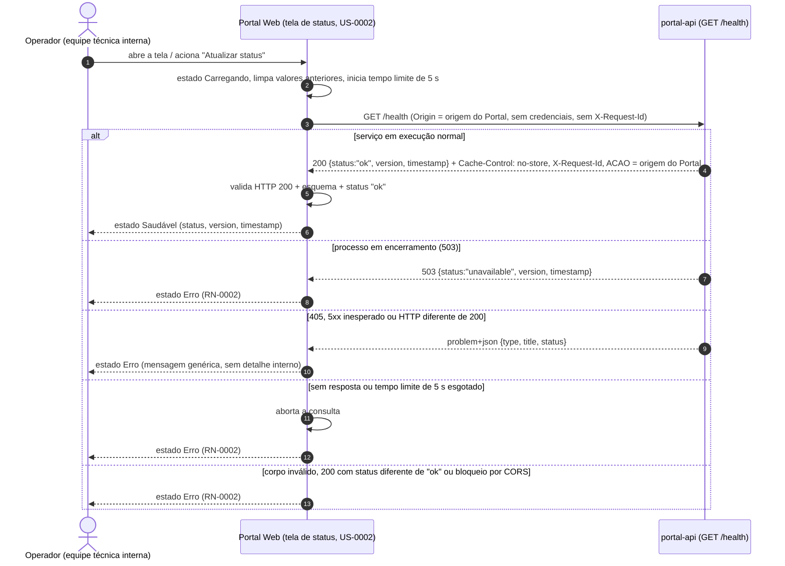

# ET-0001 — GET /health da `portal-api` (especificação técnica)

> [TESTE] DEM-2026-001 · TASK-0006 · Fluxo 01 · classe de risco R3 (DEC-ARQ-0001) · autora: AS (Juliana Castro).
> **Estado:** rascunho em revisão, redigido **sob premissa**: ADR-0001/0002/0003 estão *propostos* (v1.0, commit 362ea35) e a stack depende da AH-0001. O contrato (OpenAPI) independe da stack (ADR-0003); tudo que depende dela está marcado literalmente como **"premissa a confirmar (AH-0001)"**. A validação do contrato (G3) é do ARQ (TASK-0007) e só ocorre após a AH-0001.
> Contrato: `02-tecnica/contratos-api/portal-api/openapi.yaml` (OpenAPI 3.1, `info.version` **1.0.0**), proposto no ramo `doc/ET-0001-contrato-portal-api-health` (área protegida; aguarda merge `--no-ff` do ARQ).
> Especificação funcional par: EF-0001 v1.1.

## 1. Objetivo e escopo
Detalhar tecnicamente o recurso operacional `GET /health` da `portal-api` (API base do Portal Web, a criar): *liveness* do processo, somente leitura, que informa `status`, `version` e `timestamp` (REQ-0001) sem dado sensível (RN-0001, REQ-0004) e de forma que indisponibilidade nunca seja lida como saudável (RN-0002).

**Dentro:** rota, métodos, corpos, códigos HTTP, cabeçalhos, CORS, regras de consumo pelo Portal, tempo limite do cliente, alvo de desempenho, cenários de erro, impactos, compatibilidade e testabilidade.
**Fora (decisão de outros donos):** escolha de stack e estrutura (ARQ, ADR-0001), implementação (FS), tela (UX, US-0002), validação do contrato (ARQ, G3), modelo de dados (não há; DBA não acionado — ADR-0003 diretriz 4).

## 2. Fontes e versões consultadas
| Fonte | Versão / estado | Uso |
|---|---|---|
| ADR-0003 (health-check) | 1.0 · proposto · commit 362ea35 | Diretrizes do contrato (fonte principal) |
| ADR-0002 (SemVer e origem da versão) | 1.0 · proposto · commit 362ea35 | Formato e origem de `version` |
| ADR-0001 (stack base) | 1.0 · proposto · commit 362ea35 · aguarda AH-0001 | Somente premissas de stack e nomes de variáveis (D7) |
| US-0001, US-0002 | 1.0 · em-revisao | CA a cobrir |
| REQ-0001..REQ-0004 | 1.0 · em-revisao | Requisitos |
| RN-0001, RN-0002 | 1.0 · em-revisao | Regras aplicadas |
| DEC-ARQ-0001 | R3 (historico.md, 26/11/2026 12:22) | Classe de risco |
| contexto.yaml DEM-2026-001 | v6 (lido nas v4 a v6; commit da792b3) | Estado, riscos, pendências |
| Análise de testabilidade (QA, TASK-0005) | v1.0 · vigente · commit 80e9184 | Pontos de testabilidade e desalinhamento REQ-0001 × `503` (L-11) |
| Especificação de interface da tela (UX) | UX-ESPEC-DEM-2026-001-TASK-0004 v1.0 em revisão (commit 1290f25) | Regras de consumo do Portal (seção 5) |
| Modelos para EF/ET/contrato | **inexistentes** em `modelos/` (L-09) | Estrutura própria derivada do PROMPT.md da AS |

## 3. Premissas dependentes da stack
Todas as linhas abaixo são **premissa a confirmar (AH-0001)**; nada nesta tabela altera o contrato.

| ID | Premissa (stack proposta no ADR-0001: Node.js 24 + Fastify 5, Portal estático) | Efeito se a stack mudar |
|---|---|---|
| PS-01 | Framework/servidor HTTP da `portal-api`, host e porta de escuta: premissa a confirmar (AH-0001). Padrão seguro citado no ADR-0001 D5/D7: interface de loopback; porta não definida | Nenhum no contrato; muda só a ET/implantação |
| PS-02 | Forma de obter a `version`: lida **uma vez** na inicialização do `version` do manifesto do serviço e mantida em memória (ADR-0002 item 3; `package.json` é premissa a confirmar (AH-0001)); falha de leitura/formato ⇒ o serviço não inicia | Muda a origem; o formato SemVer do contrato permanece |
| PS-03 | Configuração e biblioteca de CORS: variável `PORTAL_API_ALLOWED_ORIGIN` (nome citado no ADR-0001 D7) e a lib que a aplica: premissa a confirmar (AH-0001) | Nenhum no contrato |
| PS-04 | Remoção de cabeçalhos que revelem servidor/versão do runtime ou framework (ADR-0003): mecanismo premissa a confirmar (AH-0001) | Nenhum no contrato |
| PS-05 | Como o processo responde durante o encerramento (necessário para o `503`): premissa a confirmar (AH-0001) — ver L-05 | Pode inviabilizar o disparo do `503` na prática; contrato mantido |
| PS-06 | Respostas padrão de `404`, `405` e `500` do framework adaptadas ao corpo padronizado; tratamento automático de `HEAD`: premissa a confirmar (AH-0001) | Nenhum no contrato |
| PS-07 | Relógio injetável e geração do `X-Request-Id`: premissa a confirmar (AH-0001) | Nenhum no contrato |
| PS-08 | Ferramenta de medição do p95 local: premissa a confirmar (AH-0001) | Só OPS/QA |
| PS-09 | Validação do corpo da resposta contra o esquema (ex.: JSON Schema) no provedor e nos testes de contrato: premissa a confirmar (AH-0001) | Só testes |

## 4. Requisitos técnicos do contrato (RT)
Referência normativa: ADR-0003 (tabela "Diretrizes do contrato"), refinada aqui; a forma executável é o `openapi.yaml` 1.0.0.

| ID | Requisito técnico | Fonte | Seção do OpenAPI |
|---|---|---|---|
| RT-01 | Rota `GET /health`, sem parâmetros de consulta, sem corpo de requisição, sem efeitos colaterais (seguro e idempotente); fora do prefixo de versão | ADR-0003 | `paths./health.get` |
| RT-02 | Sucesso: `200`, `Content-Type: application/json; charset=utf-8`; corpo com **exatamente** `status`, `version`, `timestamp` (`additionalProperties: false` no provedor); nomes em minúsculas, ASCII, inglês | ADR-0003 | `schemas.HealthOk`, `responses.Ok` |
| RT-03 | `status`: no `200` sempre `"ok"`; `"unavailable"` reservado ao `503`; valores adicionais só em versão MINOR do contrato | ADR-0003 | `HealthOk.status`, `HealthUnavailable.status` |
| RT-04 | `version`: SemVer 2.0.0 do **serviço** (não do contrato), sem `+build`, sem hash, nunca vazio; expressão `^(0\|[1-9][0-9]*)\.(0\|[1-9][0-9]*)\.(0\|[1-9][0-9]*)(-[0-9A-Za-z.-]+)?$` (ADR-0002 a sugere; finalizada aqui — DEC-AS-0003). Versão inicial do serviço 0.1.0 (ADR-0002); exemplos usam 0.1.0 | ADR-0002, ADR-0003 | `schemas.ServiceVersion` |
| RT-05 | `timestamp`: RFC 3339 / ISO 8601 em **UTC com `Z` e exatamente 3 casas de milissegundos** (`AAAA-MM-DDThh:mm:ss.sssZ`), gerado no momento da resposta pelo relógio do servidor; padrão regex no esquema. Tolerância de verificação pelo QA: **±5 s** (DEC-AS-0002) | ADR-0003 | `schemas.Timestamp` |
| RT-06 | `503`: mesmo formato do `200`, com `status: "unavailable"`; sem causa e sem detalhe. Disparo: ver seção 7.2 | ADR-0003 | `schemas.HealthUnavailable`, `responses.Unavailable` |
| RT-07 | Métodos diferentes de `GET` (e do `HEAD` tolerado): `405` com `Allow: GET`, corpo de erro padronizado | ADR-0003 | `responses.MethodNotAllowed` |
| RT-08 | Erros (`405`, `5xx` inesperado): `application/problem+json` (RFC 9457) com **somente** `type`, `title`, `status`; proposta AS: `type: "about:blank"` e `title` igual à frase do status HTTP (L-01). Nunca stack trace, caminho, nome de máquina, variável de ambiente ou qualquer detalhe interno | ADR-0003 (sugestão), RN-0001, REQ-0004 | `schemas.ProblemBase`, `ProblemMethodNotAllowed`, `ProblemInternalError` |
| RT-09 | Cabeçalhos: `Cache-Control: no-store`; `X-Content-Type-Options: nosniff`; ID de correlação `X-Request-Id` aceito/gerado e devolvido (formato restrito: L-03); **nenhum** cabeçalho que revele servidor, versão do runtime ou do framework. Aplicados a **todas** as respostas do recurso (interpretação AS — L-04) | ADR-0003 | `components.headers.*` |
| RT-10 | CORS: somente a origem do Portal configurada (`PORTAL_API_ALLOWED_ORIGIN`, premissa a confirmar (AH-0001)); sem curinga; métodos `GET`/`HEAD`; sem credenciais. Origem do Portal **concreta**: lacuna L-06 | ADR-0003, ADR-0001 D7 | `headers.AccessControlAllowOrigin` |
| RT-11 | Sem autenticação (contrato interno); condição: execução local/rede interna. Exposição fora da rede interna ⇒ contrato público (R3 + N3, nova AH) | ADR-0003 | `security: []` |
| RT-12 | Dados proibidos em corpo e cabeçalhos: dados pessoais, credenciais, tokens, hostnames, IPs, caminhos, versões de runtime/dependências, hash de commit, variáveis de ambiente, estado de dependências | ADR-0003, RN-0001 | `HealthOk` (esquema fechado) |
| RT-13 | Tempo limite do cliente (Portal): **5 s** do início da consulta até a resposta completa; sem nova tentativa automática; esgotado ⇒ erro (RN-0002) — DEC-AS-0001 | ADR-0003 (orientação), REQ-0003 | `info.description` |
| RT-14 | Desempenho: sem E/S externa; alvo **indicativo** de p95 ≤ 100 ms em execução local — **não é SLO**, não é critério de aceite; calibrar por OPS/QA | ADR-0003 | `info.description` |
| RT-15 | Observabilidade: log estruturado por requisição em nível `debug` para `/health`; erros em `error`; sem dado sensível | ADR-0003 | — |
| RT-16 | `HEAD`: tolerado (ADR-0003); semântica na seção 4.1. `OPTIONS`: não coberto pelo ADR-0003 (L-02) | ADR-0003 | descrição de `get` |
| RT-17 | Versionamento do contrato: SemVer próprio, inicial `1.0.0`, distinto da versão do serviço; campo novo opcional = MINOR; remoção/renomeação/mudança de tipo = MAJOR (ADR; AH se público) | ADR-0003 | `info.version` |

### 4.1 `HEAD` e `OPTIONS`
- **HEAD** — o ADR-0003 o declara "tolerado" e lista `HEAD` entre os métodos de CORS. Especificação adotada: se o provedor responder a `HEAD`, devolve o mesmo código e os mesmos cabeçalhos do `GET` e **nenhum corpo**. `HEAD` **não** integra a superfície prometida do contrato 1.0.0 (consumidores não devem depender dele; não há operação `head` no OpenAPI). Se o `Allow` do `405` deve listar `HEAD`, o ADR-0003 diz apenas `Allow: GET` — mantido literalmente; dúvida L-02.
- **OPTIONS** — **não coberto** pelo ADR-0003; não especificado como operação. Leitura literal de "outros métodos ⇒ 405" aplicaria o `405` também ao preflight. Como o Portal faz um `GET` "simples" (sem cabeçalhos de requisição não simples; seção 5), não há preflight e o contrato não depende dele. Dúvida L-02 ao ARQ (decisão de arquitetura).

## 5. Regras de consumo pelo Portal (consumidor tolerante)
Derivadas do ADR-0003 e da especificação de interface do UX (sem alterá-la):
1. `fetch` com tempo limite de **5 s** (RT-13), sem cache (`cache: 'no-store'`; o servidor também envia `Cache-Control: no-store`), sem polling automático; consulta ao abrir a tela e a cada ação "Atualizar status".
2. **Saudável somente se** HTTP `200` **e** corpo JSON com `status === "ok"`, `version` não vazia no padrão SemVer e `timestamp` válido (RT-05). Qualquer outra situação ⇒ **Erro/indisponível** (RN-0002): sem resposta/recusa de conexão, tempo esgotado, `503`, `405`, `5xx`, qualquer HTTP ≠ 200, corpo inválido/fora do esquema, `200` com `status` ≠ `"ok"`, resposta bloqueada por CORS.
3. Campos desconhecidos no corpo são **ignorados** (leitor tolerante); o provedor, ao contrário, nunca os envia.
4. Valores anteriores nunca são apresentados como atuais; o Portal nunca assume "saudável" por padrão.
5. Dados da resposta inseridos no DOM **somente como texto**; mensagens de erro são constantes do front, nunca derivadas da resposta de erro.
6. O Portal **não envia** `X-Request-Id` nem outros cabeçalhos de requisição não simples (mantém a requisição sem preflight; premissa AS — ver L-03).
7. Conversão do `timestamp` UTC para America/Sao_Paulo apenas na exibição (formato de exibição: UX).

## 6. Diagrama de sequência (Portal → portal-api)


## 7. Comportamento detalhado

### 7.1 Resposta `200` (CA-01 a CA-04 da US-0001)
Exemplo normativo (dados fictícios; versão do serviço inicial 0.1.0 — ADR-0002):
```
HTTP/1.1 200 OK
Content-Type: application/json; charset=utf-8
Cache-Control: no-store
X-Content-Type-Options: nosniff
X-Request-Id: <ID de correlação aceito ou gerado>
Access-Control-Allow-Origin: <origem do Portal; só quando a origem da requisição coincide>

{"status":"ok","version":"0.1.0","timestamp":"2026-11-26T15:30:00.123Z"}
```
- `timestamp` é gerado no momento da resposta (RT-05). Verificação do QA: |`timestamp` − instante de recebimento| ≤ **5 s** em execução no mesmo host (DEC-AS-0002); em teste com relógio injetável (PS-07), igualdade exata ao instante simulado.
- `version` é igual à versão do serviço em execução; o QA confere as três fontes do ADR-0002 item 6 (resposta = manifesto do commit testado = tag). Origem: PS-02.

### 7.2 Resposta `503` (RN-0002)
```
HTTP/1.1 503 Service Unavailable
Content-Type: application/json; charset=utf-8
Cache-Control: no-store
X-Content-Type-Options: nosniff
X-Request-Id: <ID de correlação>

{"status":"unavailable","version":"0.1.0","timestamp":"2026-11-26T15:30:05.456Z"}
```
- **Critério de disparo definido nas fontes:** ADR-0003 — "processo em encerramento ou, no futuro, dependência crítica fora". Hoje **não há dependência** (ADR-0003 diretriz 1), logo o único gatilho vigente é o **processo em encerramento**.
- **Não definido nas fontes (não inventado):** se e por quanto tempo o processo continua respondendo durante o encerramento (depende da stack: PS-05); uso de `Retry-After`; como o QA provoca o `503` em teste (sugestão a validar com ARQ/QA: estado de encerramento injetável no serviço de saúde) — L-05.
- Tratamento pelo Portal: sempre como Erro/indisponível (seção 5, item 2).

### 7.3 Resposta `405`
`POST`, `PUT`, `PATCH`, `DELETE` e demais métodos (exceto o `HEAD` tolerado):
```
HTTP/1.1 405 Method Not Allowed
Allow: GET
Content-Type: application/problem+json
Cache-Control: no-store
X-Content-Type-Options: nosniff
X-Request-Id: <ID de correlação>

{"type":"about:blank","title":"Method Not Allowed","status":405}
```
O corpo de erro segue a **sugestão** do ADR-0003 (RFC 9457; apenas `type`, `title`, `status`); `type` e `title` são proposta da AS (L-01).

### 7.4 Resposta `500` (erro inesperado)
`application/problem+json` com `{"type":"about:blank","title":"Internal Server Error","status":500}`; nenhuma causa, caminho ou stack trace; detalhes só em log interno (nível `error`, sem dado sensível). O Portal trata como erro (seção 5).

### 7.5 CORS
- Origem permitida: somente a configurada (PS-03); resposta traz `Access-Control-Allow-Origin` com **essa origem exata** (nunca `*`), sem `Access-Control-Allow-Credentials`.
- Origem não permitida (ou ausente): a resposta **não** traz `Access-Control-Allow-Origin`; o navegador impede a leitura pelo Portal ⇒ tratado como Erro. O contrato **não** define rejeição no servidor (por exemplo, `403`) para origem não permitida — o ADR-0003 não a prevê; clientes que não são navegador (sondas) continuam recebendo `200`. Premissa AS a confirmar pelo ARQ (L-06).
- Cabeçalhos expostos ao navegador (`Access-Control-Expose-Headers`) e permitidos (`Access-Control-Allow-Headers`): **não definidos** no ADR-0003; necessários só se o Portal precisar ler/enviar `X-Request-Id` (L-03).

## 8. Matriz de cenários de erro e exceção
| ID | Cenário | Detecção | Comportamento da `portal-api` | Comportamento do Portal (consumidor) | CA / RN | Origem da regra |
|---|---|---|---|---|---|---|
| CE-01 | Execução normal | `GET /health` | `200` com os três campos | Estado Saudável | US-0001 CA-01..04; US-0002 CA-01, CA-02 | ADR-0003 |
| CE-02 | Processo em encerramento | Sinal de encerramento | `503` `{status:"unavailable", …}` (premissa a confirmar (AH-0001), PS-05) | Erro (RN-0002) | US-0002 CA-03; RN-0002 | ADR-0003; lacuna L-05 |
| CE-03 | Serviço fora do ar (sem resposta, conexão recusada) | Falha de rede/conexão no cliente | n/a (não há resposta) | Erro; sem valor anterior | US-0002 CA-03; RN-0002 | REQ-0003, RN-0002 |
| CE-04 | Tempo limite do cliente | Sem resposta completa em 5 s | Resposta tardia é descartada | Aborta a consulta; Erro; sem nova tentativa automática | US-0002 CA-03; RN-0002 | DEC-AS-0001 |
| CE-05 | HTTP diferente de 200 (inclui `5xx`) | Código recebido | `500` problem+json para falha inesperada (sem detalhe) | Erro | US-0002 CA-03; RN-0001; RN-0002 | ADR-0003 |
| CE-06 | Corpo inválido: JSON malformado, campo ausente/vazio/formato inválido, `200` com `status` ≠ `"ok"` | Validação no cliente | Provedor nunca emite (esquema fechado, validado nos testes de contrato) | Erro | US-0002 CA-03; RN-0002 | ADR-0003 |
| CE-07 | Método inválido (`POST`, `PUT`, `PATCH`, `DELETE`, outros) | Método da requisição | `405` + `Allow: GET` + problem+json | Não aplicável (Portal só usa `GET`); se ocorrer, Erro | RN-0001 | ADR-0003 |
| CE-08 | CORS negado (origem diferente da do Portal) | Cabeçalho `Origin` | Responde sem `Access-Control-Allow-Origin` (premissa AS, L-06) | Navegador bloqueia; Erro | US-0002 CA-03 | ADR-0003 (CORS só do Portal) |
| CE-09 | Rota inexistente (qualquer caminho ≠ `/health`) | Roteamento | **Fora do contrato 1.0.0**; `404` não está coberto pelo ADR-0003 (premissa a confirmar (AH-0001), PS-06; dúvida L-04) | Não aplicável | — | lacuna L-04 |
| CE-10 | `HEAD /health` | Método | Mesmo código/cabeçalhos do `GET`, sem corpo; fora da superfície prometida (L-02) | Não utilizado | — | ADR-0003 ("tolerado") |
| CE-11 | `OPTIONS /health` (preflight) | Método | **Não definido** (L-02); leitura literal: `405` | Não ocorre (requisição simples) | — | lacuna L-02 |
| CE-12 | Chamadas repetidas | N chamadas consecutivas | Sem efeito colateral nem mudança de estado; apenas `timestamp` varia | — | US-0001 CA-06 | ADR-0003, REQ-0001 |
| CE-13 | Corpo com campos extras emitido por engano | Teste de contrato | Reprovado (`additionalProperties: false`) | Se chegar, ignora campos desconhecidos | US-0001 CA-05; RN-0001 | ADR-0003 |
| CE-14 | Resposta de erro com vazamento de detalhe interno | Inspeção de corpo/cabeçalhos | Proibido; reprovado nos testes | Não exibe conteúdo de erro | US-0001 CA-05; US-0002 CA-06; RN-0001 | REQ-0004 |

## 9. Mapa de impactos e dependências
| Componente | Impacto | Observações |
|---|---|---|
| Portal Web | **Sim — consumidor novo** (tela de status, US-0002) | Tempo limite 5 s; tratamento de todos os cenários como Erro (seção 5); CORS com a origem do Portal; `connect-src` da CSP limitado à origem da API (ADR-0003, a confirmar na stack: PS-01); DOM só com texto |
| Mobile (Java) | Nenhum | Contrato REST/JSON neutro; pode ser consumido no futuro (ADR-0001) |
| Backend/APIs | **Sim — nasce o serviço `portal-api`** (primeiro serviço) | Rota única; serviço de saúde com relógio injetável; esquema de resposta; versão lida na inicialização (PS-02) |
| Microsserviços | Nenhum | Primeiro serviço; sem dependência de outros |
| Integrações | Nenhuma externa | Sondas de monitoramento futuras usariam o mesmo endpoint, sem credenciais, só na rede interna |
| Dados | **Nenhum** | Sem banco, sem persistência, sem acesso a BD (ADR-0003 diretriz 4); DBA não acionado |
| Infraestrutura | Execução local; sem container, nuvem ou CI (ADR-0001 D5) | OPS define valores por ambiente das variáveis de configuração (somente nomes: `PORTAL_API_ALLOWED_ORIGIN` e demais, ADR-0001 D7 — premissa a confirmar (AH-0001)); sem segredos |
| Segurança/LGPD | Superfície mínima; sem dado pessoal | Condição: exposição só interna (reabre R3/N3 se mudar) |

## 10. Compatibilidade retroativa e versionamento
- **Contrato novo:** `portal-api` 1.0.0 é a primeira versão; **não há consumidores existentes** nem versão anterior; nenhuma quebra de compatibilidade.
- Consumidor previsto: Portal Web (US-0002); futuro: monitoramento e Mobile.
- Evolução (ADR-0003): campo novo opcional ou novo valor de `status` ⇒ MINOR; remoção, renomeação ou mudança de tipo ⇒ MAJOR (ADR; AH se público). Como o Portal é leitor tolerante, campos novos opcionais são compatíveis.
- `info.version` (contrato, 1.0.0) é distinta da `version` do corpo (serviço, 0.1.0 na primeira entrega; ADR-0002 só admite 1.0.0 do serviço na primeira release declarada estável).

## 11. Testabilidade (insumo para o QA — TASK-0005/0010)
| Tipo | O que verificar | CA / RN |
|---|---|---|
| Contrato (provedor) | `200` e `503` válidos contra o esquema aprovado; ausência de campos extras; `version` no padrão; `timestamp` no padrão com milissegundos e `Z` | US-0001 CA-01..04 |
| Contrato (provedor) | `405` com `Allow: GET` e corpo problem+json; `500` sem detalhe | US-0001 CA-05; RN-0001 |
| Cabeçalhos | `Cache-Control: no-store`, `X-Content-Type-Options: nosniff`, `X-Request-Id`; ausência de cabeçalhos que revelem servidor/framework/runtime | US-0001 CA-05 |
| Segurança | Corpo e cabeçalhos sem dado proibido (RT-12); CORS sem curinga e sem credenciais | US-0001 CA-05; RN-0001 |
| Versão | Resposta = manifesto do commit testado = tag (ADR-0002 item 6) | US-0001 CA-04 |
| Timestamp | Tolerância ±5 s (ou exata com relógio injetável) | US-0001 CA-03 |
| Somente leitura | Várias chamadas sem alterar estado | US-0001 CA-06 |
| Consumidor (Portal, mocks do contrato — PR-04) | Corpo inválido, tempo esgotado (5 s), `503`, `405`, `5xx`, `200` com `status` ≠ `"ok"`, bloqueio CORS ⇒ Erro; recuperação após a API voltar | US-0002 CA-03, CA-05; RN-0002 |
| Desempenho (informativo) | p95 ≤ 100 ms local; **não bloqueia** aceite nem é SLO | ADR-0003 |
| `503` | Exige estado de encerramento injetável (L-05) | RN-0002 |

## 12. Lacunas, dúvidas e dependências
| ID | Lacuna / dúvida | Dono | Efeito se não resolvida |
|---|---|---|---|
| L-01 | O ADR-0003 apresenta RFC 9457 (`application/problem+json`; só `type`, `title`, `status`) como **sugestão**, sem definir os valores. Adotado como proposta: `type: "about:blank"`, `title` = frase do status HTTP. Confirmar ou definir o padrão da plataforma | ARQ | Corpo de erro pode mudar (MAJOR se mudar tipo/campos depois do G3) |
| L-02 | `HEAD` "tolerado": confirmar a semântica adotada (4.1) e se o `Allow` do `405` deve ser `GET` ou `GET, HEAD`; `OPTIONS` não é coberto — definir (405 literal, ou resposta de preflight) | ARQ | Ambiguidade de implementação e de teste |
| L-03 | `X-Request-Id`: "formato restrito" não definido (padrão/tamanho); se o Portal precisar ler ou enviar o ID, faltam `Access-Control-Expose-Headers`/`Access-Control-Allow-Headers` e preflight (L-02). Premissa AS: o Portal não envia nem lê o ID | ARQ | Risco de injeção em log se aceito sem restrição |
| L-04 | `404` de rotas inexistentes e demais respostas de erro fora do `405`/`500`; confirmar que `Cache-Control: no-store` e `nosniff` valem para **todas** as respostas do recurso (interpretação AS) | ARQ | Comportamento do framework por omissão |
| L-05 | `503`: ADR-0003 só cita "processo em encerramento"; falta definir se o processo responde durante o encerramento (depende da stack, PS-05), `Retry-After` e como provocar o `503` em teste (testabilidade) | ARQ (com QA) | `503` pode ser inalcançável ou não testável |
| L-06 | Origem **concreta** do Portal (valor de `PORTAL_API_ALLOWED_ORIGIN`; portas indefinidas); e confirmar que origem não permitida = ausência de `Access-Control-Allow-Origin` (sem `403` no servidor) | ARQ / OPS | Sem valor, a CORS não é configurável nem testável |
| L-07 | Confirmar as decisões DEC-AS-0001..0003 (delegadas à AS pelo ADR-0003/ADR-0002, mas com efeito no contrato) | ARQ | Revisão do contrato |
| L-08 | US-0001, US-0002 e REQ-0004 ainda citam "R2 (padrão)", e o contexto/DEC-ARQ-0001 confirmam **R3** (CONF-0001); US/RN estão `em-revisao` (G1 pendente): mudança de CA exige revisão desta ET | PO | Rastreabilidade sobre v1.0 pode ser invalidada |
| L-09 | Não existem modelos EF/ET/contrato em `modelos/` nem `INDEX.md` na base; estrutura própria usada | DOC | Padronização futura |
| L-11 | REQ-0001 e US-0001 só preveem `200`; o contrato inclui `503`, `405` e `500` (ADR-0003) sem CA/REQ de escopo correspondente (apontado pelo QA, TASK-0005), e US-0001 CA-04 cita "build/commit" enquanto o ADR-0002 proíbe hash de commit na resposta. Alteração de requisito identificada na especificação: decisão do PO (incluir CA/REQ para `503`/`405`/`500` e alinhar CA-04) | PO | `503`/`405`/`500` ficam sem critério de aceite próprio no G5 |
| L-10 | Dependência: **AH-0001** (stack, N3) — G3 só após a decisão; TASK-0007 (ARQ) valida o contrato | ORQ / ARQ | Contrato permanece "proposto" |

## 13. Decisões na alçada da AS
| ID | Decisão | Justificativa |
|---|---|---|
| DEC-AS-0001 | Tempo limite do cliente (Portal → `GET /health`) = **5 s**, do início da consulta à resposta completa, **sem nova tentativa automática** (atualização só manual) | ADR-0003 deixa "orientação de 5 s, a fechar pelo AS"; REQ-0003 delega à AS/ARQ; UX adotou 5 s como premissa (P-UX-05); ADR-0003 exclui polling automático |
| DEC-AS-0002 | Tolerância de verificação do `timestamp` (US-0001 CA-03) = **±5 s** (exata com relógio injetável) | ADR-0003 deixa "± 5 s, a confirmar pelo AS na ET" |
| DEC-AS-0003 | Expressões finais de validação de `version` (SemVer sem `+build`) e de `timestamp` (UTC, `Z`, 3 casas de milissegundos) no OpenAPI | ADR-0002 ("o AS finaliza") e ADR-0003 |

Fora da alçada (não decidido): classe de risco, stack, formato de erro definitivo, exposição, CORS concreto, semântica de `HEAD`/`OPTIONS` — ver seção 12.

## 14. Rastreabilidade (CA da US-0001 ↔ RT)
| CA | Requisitos técnicos | Cenários | Esquema/operação no OpenAPI |
|---|---|---|---|
| US-0001 CA-01 (três campos, HTTP 200) | RT-01, RT-02 | CE-01, CE-13 | `HealthOk`, `responses.Ok` |
| US-0001 CA-02 (status saudável permitido) | RT-03 | CE-01 | `HealthOk.status` (`ok`) |
| US-0001 CA-03 (timestamp) | RT-05; DEC-AS-0002 | CE-01 | `Timestamp` |
| US-0001 CA-04 (versão rastreável) | RT-04; PS-02 | CE-01 | `ServiceVersion` |
| US-0001 CA-05 (sem dados sensíveis) | RT-08, RT-09, RT-12 | CE-05, CE-07, CE-13, CE-14 | `ProblemBase`, cabeçalhos, esquemas fechados |
| US-0001 CA-06 (somente leitura) | RT-01 | CE-12 | `operationId getHealth` (seguro e idempotente) |
Matriz completa CA ↔ RN ↔ REQ ↔ EF/ET/contrato: EF-0001 seção 7.

## 15. Histórico de versões
| Versão | Data/hora | Autor | Mudança |
|---|---|---|---|
| 1.0 | 26/11/2026 12:27 | AS | Criação (TASK-0006), sob premissa dos ADRs propostos e da AH-0001 (commit 950ebff) |
| 1.1 | 26/11/2026 12:33 | AS | Acrescenta L-11 (cobertura de `503`/`405`/`500` por CA/REQ e CA-04 × ADR-0002) e a fonte QA TASK-0005; sem mudança de contrato |
